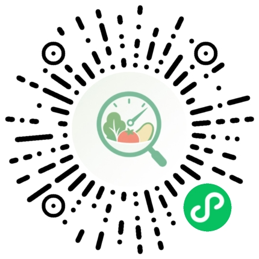

# 配套工具：食探管吃，教链管练

> 【利益相关】本页介绍的都是发起人团队开发的产品。它们没有经过独立研究验证，证据等级统一为 **C**。指南里每一条都能脱离这些工具执行，用不用全凭自愿。

指南告诉你**该怎么做**，工具帮你**每天做到**。下面按"你遇到的问题"来对照。

## 食探：管吃

微信小程序。扫码或在微信里搜索「食探」。

| 你遇到的问题 | 用食探的哪个功能 | 对应指南 |
|---|---|---|
| 不知道这顿有多少蛋白质、多少热量 | **拍照记录 / 文字记录**：AI 估算热量和三大营养素；想更准用**精准分析** | [2.1](../guide/02-饮食/)、[2.5](../guide/02-饮食/) |
| 这顿吃得对不对 | **整餐点评**：告诉你这顿缺什么、多了什么 | [2.3](../guide/02-饮食/)、[2.7](../guide/02-饮食/) |
| 吃食堂不知道选什么 | **美食图谱 → 食堂**：按学校、校区、食堂、窗口浏览菜品；也可以上传你食堂的菜，帮同学补全 | [2.3](../guide/02-饮食/) |
| 减脂、增肌速度对不对 | **记体重 / 体重趋势 / 身体趋势**：看周平均和曲线 | [2.2](../guide/02-饮食/)、[2.6](../guide/02-饮食/) |
| 睡够了没有 | **记录睡眠** | [3.1](../guide/03-睡眠与恢复/)、[3.2](../guide/03-睡眠与恢复/) |
| 肌酸、蛋白粉吃了没 | **补剂柜** | [2.4](../guide/02-饮食/) |
| 一周下来整体怎么样 | **上周回顾 / 健康指数**（连续记录 2 天以上才会显示） | — |
| 想找人一起吃 | **约饭**：发起约饭、喊朋友一起吃，俱乐部群友可以直接约 | — |
| 一个人坚持不下来 | **签到打卡、排行榜、好友、圈子** | [7 天打卡](../challenge/) |

**北清同学**：美食图谱里的清北食堂菜品还在补充。你在食堂拍的菜上传上去，就是在帮整个俱乐部完善"北清食堂高蛋白地图"。

**不用食探怎么做**：按 [2.3](../guide/02-饮食/) 的手掌法估算，用手机备忘录记体重和睡眠。

## 教链：管练

微信小程序。在微信里搜索「教链」。（小程序码待补充）

| 你遇到的问题 | 用教链的哪个功能 | 对应指南 |
|---|---|---|
| 不知道练什么 | **计划库**：多套现成训练计划，选一套就能按天执行；也可以自己建计划 | [1.5](../guide/01-训练/) |
| 手里有博主或朋友给的计划（文字、表格、截图） | **智能导入**：AI 把它解析成可以逐天执行的计划 | — |
| 不知道每组该用多重 | **自动算重量**：按你的 1RM、RM 或百分比算出每组重量；引体、俯卧撑这类自重动作会把体重算进去 | [1.6](../guide/01-训练/)、[6.7](../guide/06-引体向上/) |
| 记不住练了什么 | **今日训练、逐组记录**；自动标出 **PR**，用 **e1RM 进步足迹**看力量曲线 | [1.1](../guide/01-训练/)、[1.6](../guide/01-训练/) |
| 动作不会做 | **动作库示范视频** | [1.8](../guide/01-训练/)、[6.6](../guide/06-引体向上/) |
| 不确定动作对不对 | **上传训练视频，请教练点评** | [6.6](../guide/06-引体向上/) |
| DDL 周练不了 | 计划**允许跳过某天**，进度不会乱；可以提前建一套"保命版"计划 | [5.1](../guide/05-场景篇/) |
| 想要真人带练 | **教练发现页**：看教练主页、填问卷、订阅（按实际训练日计次） | — |
| 想和别人比一比 | **排行榜**：提交成绩，审核后上榜 | [6.2](../guide/06-引体向上/) |

**计划库里的现成计划**（名单待补充）：

| 计划 | 适合谁 | 对应指南 |
|---|---|---|
| （待补充） | | |

**不用教链怎么做**：照 [1.5](../guide/01-训练/) 和 [7 天打卡](../challenge/)的示例练，用纸笔记录"动作 × 重量 × 次数"。

## 健文社区：管圈子

用名片墙记录卧推、深蹲、硬拉三大项成绩和"我能提供 / 我在寻找"，方便找同校训练搭子；工具箱里有 1RM 计算器；"用户心声"看板收集大家对俱乐部和产品的建议。（链接待补充）

## 发现工具和指南冲突？

以指南为准，并[提 issue](../CONTRIBUTING.md) 告诉我们。按[利益相关规则](../README.md#利益相关)，我们改产品，不改指南。
